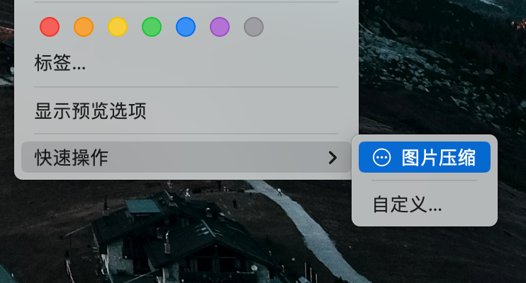
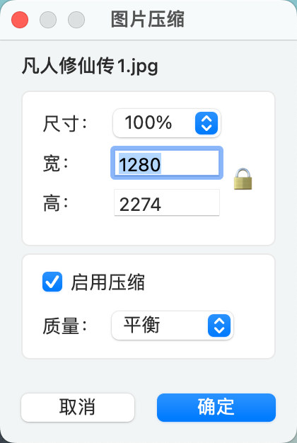

# 图片压缩 - macOS 快速操作

一个通过右键菜单快速操作实现图片压缩和尺寸调整的Mac工具。

## ✨ 特性

- 🚀 **操作方便** - 右键菜单 → 快速操作 → 图片压缩
- 💾 **智能压缩** - 可选压缩率（最佳/高/平衡/低）
- 📊 **批量处理** - 支持同时处理多张图片
- 🖼️ **格式保留** - 输入什么格式，导出即保持该格式（PNG/JPEG/HEIC/WebP/GIF/TIFF/BMP）
- 🖼️ **WebP 支持** - 原生 WebP 压缩与改分辨率（内置 cwebp，无需额外安装）
- 🖼️ **PNG 无损压缩** - pngquant 转调色板 PNG，体积直降 60-80%，保留透明通道
- 🔨 **零外依赖** - PKG 内置 pngquant + cwebp 及全部依赖库，目标机无需 Homebrew
- 🌓 **深色模式** - 适配 macOS 深色/浅色模式

## 📖 使用方法

1. 在 Finder 中选择一张或多张图片
2. 点击右键
3. 选择 **快速操作 → 图片压缩**
4. 在弹出的对话框中：
   - 设置图片分辨率
   - 选择是否启用压缩（默认启用）
   - 选择压缩质量（默认平衡档）
5. 点击"确定"开始处理
6. 处理完成的图片保存在原图同目录，文件名为 `原文件名_resized.<原扩展名>`
   （输入 jpg → 输出 jpg，输入 png → 输出 png，输入 webp → 输出 webp，以此类推）




## 🖼️ 支持的格式与处理方式

| 输入格式 | 改分辨率 | 压缩 | 输出格式 | 压缩工具 |
|---------|---------|------|---------|---------|
| PNG | ✓ | ✓ | PNG | pngquant（调色板化，保留透明） |
| JPEG | ✓ | ✓ | JPEG | sips formatOptions |
| HEIC | ✓ | ✓ | HEIC | sips formatOptions |
| WebP | ✓ | ✓ | WebP | cwebp |
| GIF/TIFF/BMP | ✓ | 跳过（无损格式） | 原格式 | — |

> **无损格式（GIF/TIFF/BMP）不执行压缩**——这些格式本身无损，二次压缩只会增大体积或损失质量。
> 仅执行缩放，输出保持原格式。PNG 经 pngquant 调色板化后为有损但视觉无损，仍保留透明通道。

## 🚀 安装&卸载

### 使用 PKG 安装包

1. 下载 [最新版本](https://github.com/SalvinTang/image_Compression/releases)
2. 双击 PKG 文件
3. 按照安装向导操作
4. 输入管理员密码
5. 安装完成后立即可用

### 卸载
终端中输入：
```sh
sudo rm -rf "/Library/Services/图片压缩.workflow"
```

## 🤔 可能的问题
安装时提示："无法打开，因为它来自身份不明的开发者。"

解决办法：打开系统设置 → 隐私与安全性 → 下滑找到“安全性” → 选择“仍要打开”


## 📄 许可证

MIT License


## 🙏 致谢

- 参考项目：[video-info-action](https://github.com/Gecho-Go/video-info-action)

---

